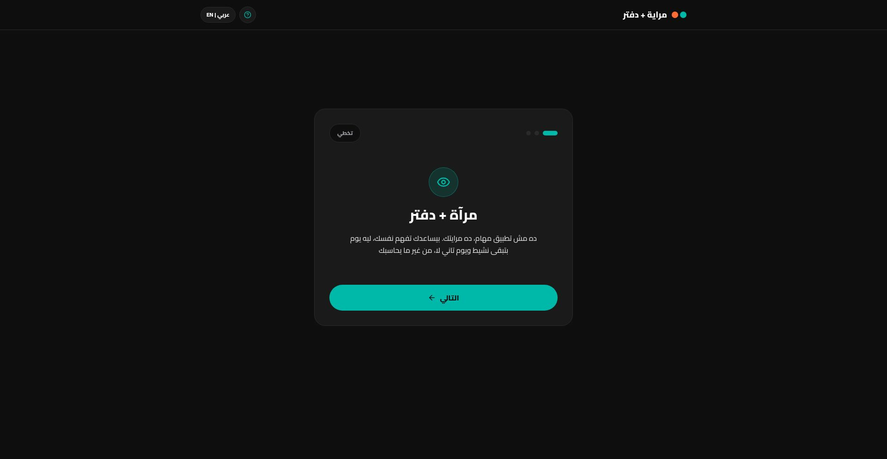

# Mirror + Ledger | مراية + دفتر

A personal habit and feelings tracker. Log what you did (the ledger) and how you felt (the mirror), then review your day and week in a report.

**Live app:** https://mirror-ledger.ai.studio/



This is a personal project, built with AI tools (Google AI Studio) and still under development.

## Features

- Action ledger and daily check-in
- Feeling mirror and reports
- Arabic and English interface
- Installable offline web app (PWA)
- Optional cloud sync, focus map, ambient sounds and a small focus game

## Run locally

```bash
bun install
bun run dev
```

Copy `.env.example` to `.env` and fill in your own values. Never commit real keys.

## Privacy

Data is stored on the user's device by default. Cloud backup is optional and manual: signing in with Google and pressing sync saves a copy to the user's own account. The server stores only an account id, not email, name or photo. The user can delete the account and all cloud data from Settings, and can export or erase local data at any time.

## Status

Under development.

## Copyright

Copyright (c) 2026 Abdullah Ayman. All rights reserved.
